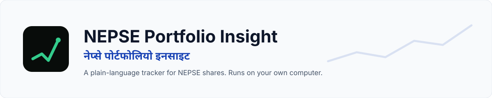
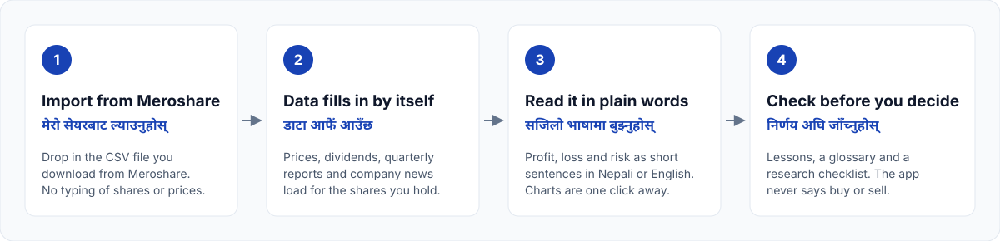
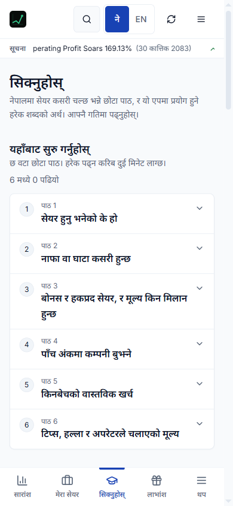
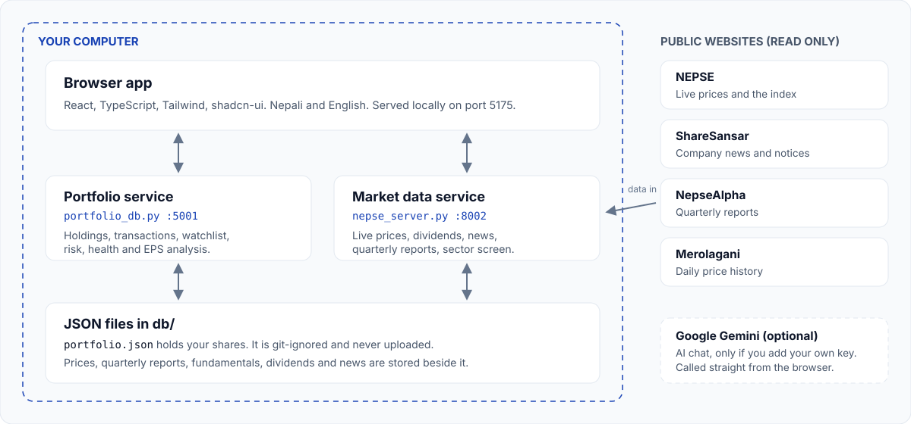

<p align="center">
  
</p>

<p align="center">
  <a href="#नेपाली"><b>नेपाली</b></a> &nbsp;|&nbsp; <a href="#english"><b>English</b></a>
</p>

---

# नेपाली

**नेप्से पोर्टफोलियो इनसाइट** नेप्सेमा सेयर राख्ने साधारण लगानीकर्ताका लागि बनाइएको एप हो। यसले तपाईंको लगानी कस्तो चलिरहेको छ भनेर सजिलो नेपालीमा बताउँछ। एप तपाईंकै कम्प्युटरमा चल्छ, र तपाईंका सेयरको विवरण कतै पठाइँदैन।

## यसले के गर्छ

<p align="center">
  
</p>

- **एक पटक फाइल हाल्नुहोस्।** मेरो सेयरबाट डाउनलोड गरेको CSV फाइल एपमा हाल्नुहोस्। सेयरको नाम, कित्ता वा मूल्य टाइप गर्नु पर्दैन।
- **डाटा आफैँ आउँछ।** बजार मूल्य, लाभांश, त्रैमासिक रिपोर्ट र कम्पनीका समाचार आफैँ भरिन्छन्।
- **सजिलो भाषा।** "तपाईंले रु. 3,49,235 लगानी गर्नुभएको छ। आज यसको बजार मूल्य रु. 3,87,755 छ।" जस्ता छोटा वाक्यमा जानकारी आउँछ। चार्ट र तालिका हेर्न मन लागे "विस्तृत" थिच्नुहोस्।
- **नेपाली र अंग्रेजी दुवै।** एप नेपालीमा खुल्छ। एक क्लिकमा अंग्रेजीमा बदल्न सकिन्छ। अंक मेरो सेयर र TMS मा जस्तै देखिन्छन्, र मिति विक्रम संवत्‌मा।
- **सल्लाह होइन, जानकारी।** एपले कहिल्यै "किन्नुहोस्" वा "बेच्नुहोस्" भन्दैन। यसले तपाईंका अंकले के देखाउँछन् भनेर बताउँछ र आफैँ जाँच्ने तरिका सिकाउँछ।
- **फोनको आकारमा पनि मिल्छ।** सबै पृष्ठ साँघुरो स्क्रिनमा जाँचिएका छन्। अहिले एप ल्यापटपमा मात्र चल्छ; फोनबाट प्रयोग गर्ने योजना [docs/HOSTING_PLAN.md](docs/HOSTING_PLAN.md) मा छ।

## एपका पृष्ठहरू

| पृष्ठ | के देखिन्छ |
| --- | --- |
| **सारांश** | कति लगानी भयो, आज कति मूल्य छ, नाफा वा घाटा, ध्यान दिनुपर्ने कुरा, तपाईंका सेयरका समाचार |
| **सिक्नुहोस्** | छ वटा छोटा पाठ र 61 शब्दको शब्दकोश (नेपाली र अंग्रेजी) |
| **जोखिम** | पोर्टफोलियो कति घटबढ हुन्छ, सबैभन्दा ठूलो गिरावट, कुन सेयर सँगै घटबढ हुन्छन् |
| **अध्ययन** | सेयर किन्नुअघि सोध्नुपर्ने छ प्रश्न, र हरेक क्षेत्रमा के जाँच्ने भन्ने सूची |
| **लाभांश** | नगद लाभांश र बोनस सेयर, आर्थिक वर्ष अनुसार |
| **त्रैमासिक** | कम्पनीका त्रैमासिक रिपोर्टका मुख्य अंक र गत वर्षसँगको तुलना |
| **मूल्याङ्कन, बजार, क्षेत्र तुलना, उपकरण** | P/E र किताबी मूल्य, आजको बजार र नयाँ निष्कासन, क्षेत्रभित्र कम्पनीको क्रम, स्वास्थ्य अंक र बचत प्रक्षेपण |

<p align="center">
  
</p>

<p align="center">
  
</p>

## मेरो सेयरबाट फाइल कसरी निकाल्ने

1. **मेरो सेयर (Meroshare)** मा लग इन गर्नुहोस्।
2. **My Purchase Source** खोल्नुहोस्।
3. **CSV** थिच्नुहोस्। फोनमा भए तीन थोप्ले मेनु थिचेर **CSV** छान्नुहोस्।
4. त्यो फाइल एपको "फाइल हाल्नुहोस्" बाकसमा हाल्नुहोस्। पहिलो पटक एप खोल्दा यो बाकस आफैँ देखिन्छ।

WACC रिपोर्टको CSV पनि चल्छ।

## एप कसरी चलाउने (Windows)

पहिलो पटक मात्र, एप फोल्डरमा यी आदेश चलाउनुहोस्। यसका लागि [Node.js](https://nodejs.org) र [Python](https://www.python.org) चाहिन्छ।

```sh
npm install
python -m venv .venv
.venv\Scripts\pip install -r requirements.txt
copy db\portfolio.example.json db\portfolio.json
```

त्यसपछि `Portfolio-Nepse-Setup.bat` मा डबल क्लिक गर्नुहोस्। यसले Start मेनु र डेस्कटपमा **Portfolio Nepse** नामको सर्टकट बनाउँछ।

हरेक दिन:

- **खोल्न:** Start मेनु वा डेस्कटपबाट **Portfolio Nepse** खोल्नुहोस्। ब्राउजरमा `http://localhost:5175` आफैँ खुल्छ।
- **बन्द गर्न:** एपको माथि दायाँ कुनामा रहेको पावर बटन थिच्नुहोस्, वा `Stop-Portfolio-Nepse.bat` चलाउनुहोस्।

## तपाईंको गोपनीयता

तपाईंका सेयर `db/portfolio.json` फाइलमा तपाईंकै कम्प्युटरमा बस्छन्। यो फाइल git मा जाँदैन र कतै अपलोड हुँदैन। एपले इन्टरनेटबाट बजारको डाटा मात्र लिन्छ।

AI च्याट ऐच्छिक हो। आफ्नै Gemini API की राख्नुभयो भने मात्र चल्छ, र त्यस बेला तपाईंको प्रश्न Google मा जान्छ।

## ध्यान दिनुहोस्

यो एप जानकारी र सिकाइका लागि हो। यो लगानी सल्लाह होइन। कुनै पनि निर्णय गर्नुअघि हरेक अंक नेप्से, मेरो सेयर र कम्पनीको आफ्नै रिपोर्टमा जाँच गर्नुहोस्। जोखिमका अंक विगतको मूल्यबाट निकालिएका अनुमान हुन्, भविष्यको प्रतिफल होइनन्।

नेपाली शब्द छनोटमा सुधार गर्नुपर्ने ठाउँ देख्नुभयो भने issue खोलेर बताउनुहोस्।

---

# English

**NEPSE Portfolio Insight** is a portfolio tracker for ordinary investors on the Nepal Stock Exchange. It tells you how your money is doing in plain sentences, in Nepali or English. It runs on your own computer, and your holdings are not sent anywhere.

## What changed since the last README

The earlier README (July 2026) described a dark, English-only dashboard. It is kept at [docs/archive/README-2026-07.md](docs/archive/README-2026-07.md). Since then:

- **Nepali-first interface.** Every page is in Nepali and English. Dates use Bikram Sambat; digits stay Latin so they match Meroshare and TMS.
- **Simple view by default.** The first screen is a few sentences about your money. Charts and tables are behind the Advanced switch.
- **Light redesign.** A clean light theme, with dark mode available. Section headings are the questions a reader asks: "How am I doing?", "What do I own?", "What should I look at?".
- **New pages.** Risk, Research and Learn.
- **No buy or sell wording.** The app describes your numbers and teaches you how to check a company. It does not give instructions.
- **News reading.** Company notices are sorted into events (results, dividends, book closure) by fixed rules in Python. No AI model is involved.
- **Phone layout.** All pages are checked at 360 px wide.
- **Published research.** The sector ranking has a pre-registered backtest and a running forward test, with the results reported as found.

## How it works

<p align="center">
  
</p>

## Screens

### Overview

Simple view gives the answer in sentences. Advanced view adds the value trend, a comparison with the NEPSE index, sector split, a health grade, the holdings table, watchlist and news.

### Risk

How much the portfolio swings compared with the market, the deepest fall so far, which sectors carry more risk than their share of money, and which holdings move together.

### Dividends

Cash dividends after tax and bonus shares for each fiscal year. Bonus shares are valued at the last traded price.

### Quarterly reports

The main figures from each company's quarterly reports, how they are moving, and how they compare with the same period last year.

### All pages

| Page | Route | What it shows |
| --- | --- | --- |
| Overview | `/` | Value, profit or loss, things to look at, news for your shares |
| Learn | `/learn` | Six short lessons and a 61-term glossary in both languages |
| Risk | `/risk` | Volatility, drawdown, share of risk by sector and by holding, correlation |
| Research | `/research` | Six questions to answer before buying, and a checklist for each sector |
| Dividends | `/dividends` | Cash and bonus dividends by fiscal year |
| Quarterly | `/quarterly` | Quarterly report figures with year-on-year comparison |
| Valuation | `/fundamentals` | P/E, book value and related ratios |
| Market | `/market` | Today's market, new share issues, shares near their 52-week high or low |
| Sector screen | `/intelligence` | Companies ranked within their sector, and Nepal policy research papers |
| Tools | `/misc` | Health score, value over time, savings projector, money by sector |

Keyboard shortcuts: press `g` then a letter to jump to a page (`g r` for Risk, `g d` for Dividends), `/` to search for a stock, `t` to switch theme, `?` to list all shortcuts.

## Getting your portfolio from Meroshare

1. Log in to **Meroshare**.
2. Open **My Purchase Source**.
3. Click **CSV**. On a phone, open the three-dot menu, then **CSV**.
4. Drop the file into the app's import box. It is shown on first run.

The WACC report CSV also works.

## Running the app (Windows)

You need [Node.js](https://nodejs.org) and [Python](https://www.python.org).

### First-time setup

```sh
npm install
python -m venv .venv
.venv\Scripts\pip install -r requirements.txt
copy db\portfolio.example.json db\portfolio.json
```

Then double-click `Portfolio-Nepse-Setup.bat`. It adds a **Portfolio Nepse** shortcut to the Start menu and the desktop.

### Daily use

- **Start:** open **Portfolio Nepse** from the Start menu or desktop. You can also double-click `PortfolioInsight.vbs` or `start.bat`, or run `npm start`.
- **Stop:** use the power button at the top right of the app, run `Stop-Portfolio-Nepse.bat`, or run `npm run stop`.

The app opens at `http://localhost:5175`.

## How it is built

<p align="center">
  
</p>

| Part | What it is | Port |
| --- | --- | --- |
| Screen | React, TypeScript, Vite, Tailwind CSS, shadcn-ui, Recharts | 5175 |
| Portfolio service | `portfolio_db.py`, Python standard-library HTTP server | 5001 |
| Market data service | `nepse_server.py`, Flask | 8002 |
| Data | JSON files in `db/` | |

Repository layout:

```
src/          React app. UI text lives in src/i18n/locales/{ne,en}/
tools/        Python scripts: scrapers, risk, health, EPS, backtest, and their tests
workflows/    Written procedures for each data job (prices, dividends, quarterly, news)
db/           JSON data. portfolio.json is personal and git-ignored
docs/         Research documents, hosting plan, images, archived README
scripts/      Windows setup, launch and uninstall scripts
```

Data sources: NEPSE (live prices and index, through an unofficial library), ShareSansar (company news), NepseAlpha (quarterly reports), Merolagani (daily price history). All are read by scraping public pages, which is acceptable for one person's private use. Read [docs/HOSTING_PLAN.md](docs/HOSTING_PLAN.md) before running this as a public service.

Tests:

```sh
.venv\Scripts\python.exe -m pytest tools/ -q
```

## Research: does the sector ranking work?

The Sector screen ranks companies inside each sector on reported profit, growth, safety, dividends and price against earnings. Before showing that ranking as anything more than a starting point, it was tested.

- The scoring rules were frozen and the test was written down in advance: [PHASE2_PREREGISTRATION.md](docs/research/PHASE2_PREREGISTRATION.md).
- The backtest covers 15 quarterly periods from December 2022 to September 2026, about 163 eligible companies at each rebalance.
- **Result:** no evidence that holding the top three companies in each sector beat holding every eligible company in the same sectors. Higher-ranked companies did slightly better than lower-ranked ones within a sector, but the signal is weak and concentrated in recent periods. Full figures: [PHASE2_RESULTS.md](docs/research/PHASE2_RESULTS.md).
- A forward test records the picks at each quarterly rebalance before returns are known, through December 2027: [FORWARD_TEST_PROTOCOL.md](docs/research/FORWARD_TEST_PROTOCOL.md).

The app states this result next to the ranking.

## Privacy

Your holdings are stored in `db/portfolio.json` on your computer. That file is git-ignored, so it is never committed or pushed. The repository ships only `db/portfolio.example.json`, an empty template. The app goes online only to read market data.

AI chat is optional. It works only if you add your own Gemini API key, and when you use it your question goes to Google.

## Disclaimer

This app is for information and learning. It is not investment advice. Check every number against NEPSE, Meroshare and the company's own reports before you decide anything. Risk figures are estimates from past prices, not forecasts. The value checks follow ideas from Benjamin Graham's *The Intelligent Investor*.
